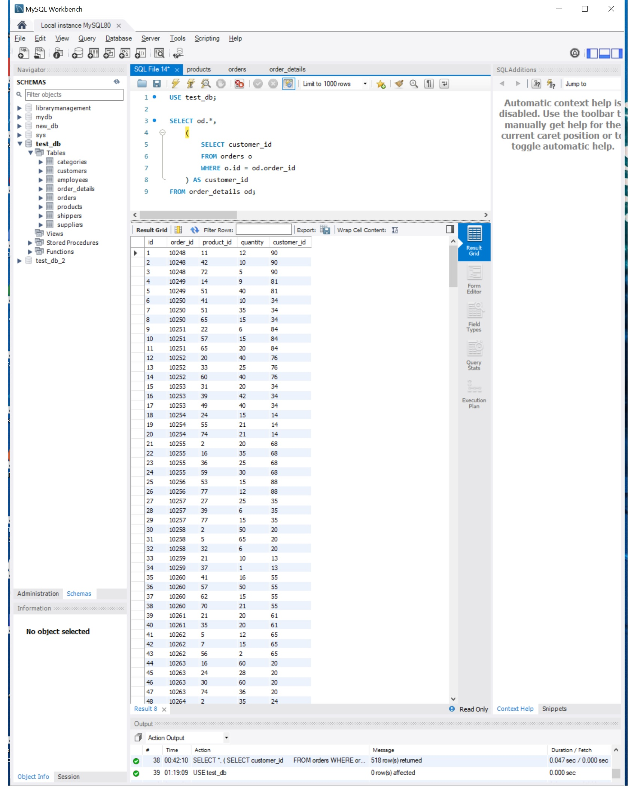
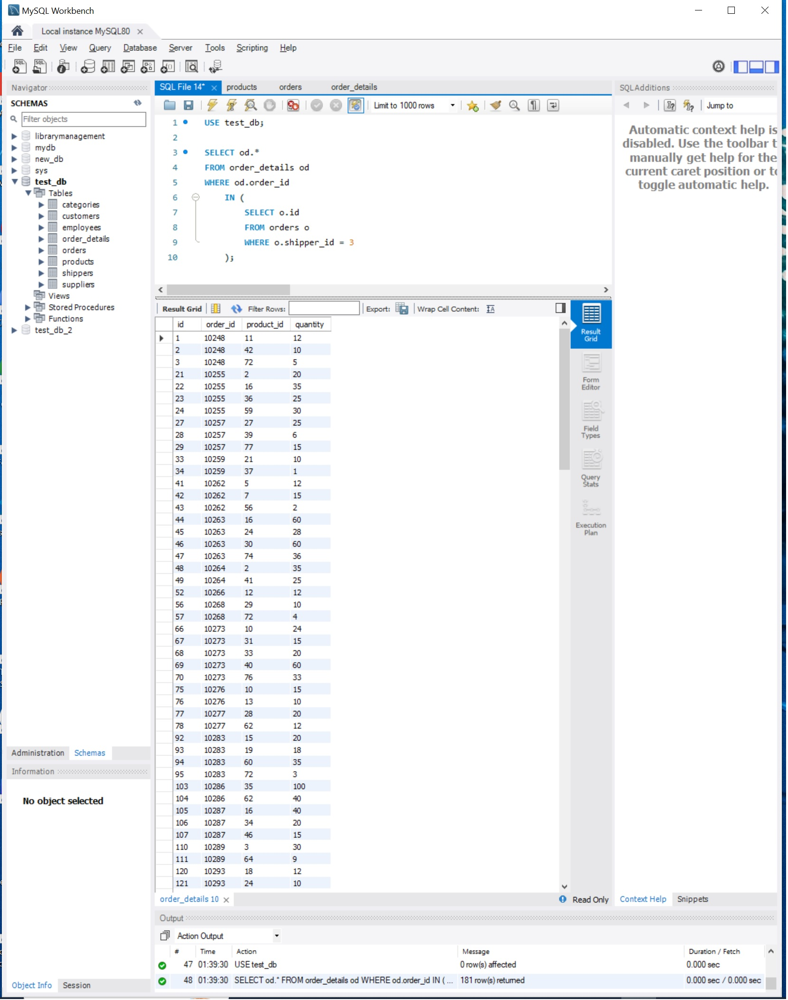
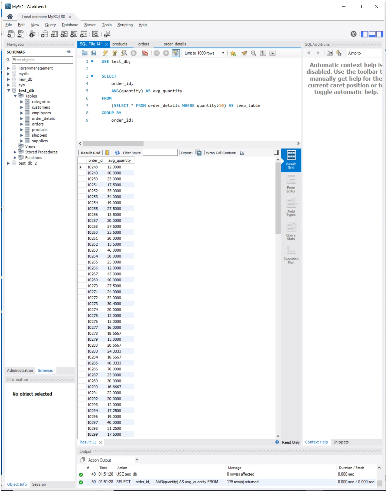
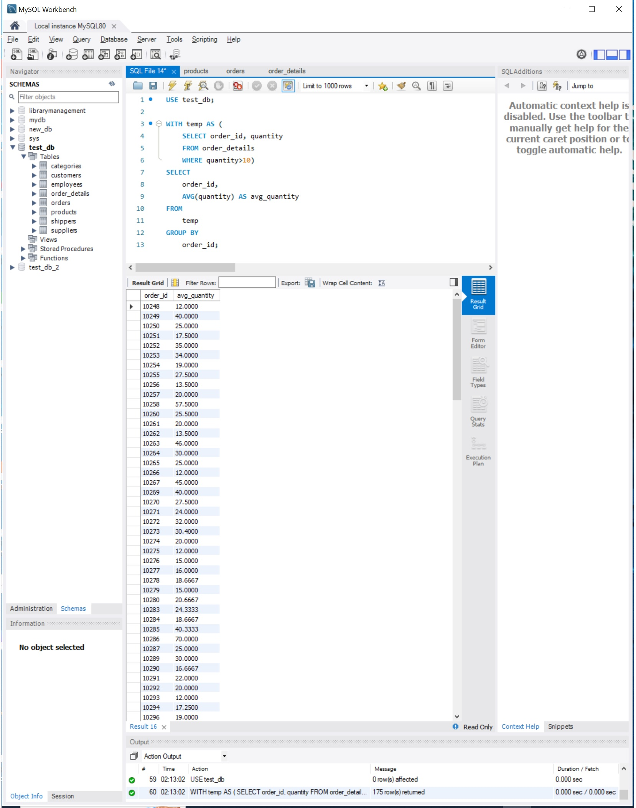
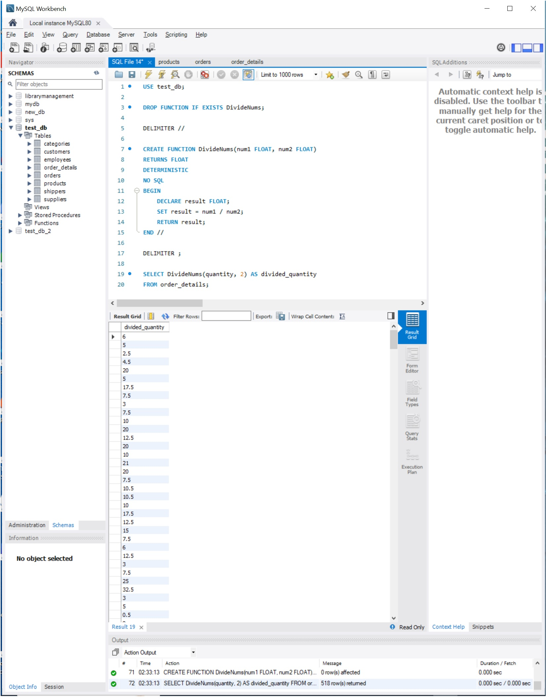

# Практична робота: Вкладені запити, CTE та користувацькі функції в MySQL

---

## Завдання 1. Вкладений запит в операторі SELECT

### Умова
Напишіть SQL-запит, який буде відображати таблицю `order_details` та поле `customer_id` з таблиці `orders` відповідно для кожного рядка таблиці `order_details`.  
Це має бути зроблено за допомогою вкладеного запиту в операторі `SELECT`.

### SQL-код
```sql
USE test_db;

SELECT 
    od.*,
    (
        SELECT o.customer_id 
        FROM orders o
        WHERE o.id = od.order_id
    ) AS customer_id
FROM order_details od;
```

### Результат виконання


---

## Завдання 2. Вкладений запит в операторі WHERE

### Умова
Напишіть SQL-запит, який буде відображати таблицю `order_details`. Відфільтруйте результати так, щоб відповідний запис із таблиці `orders` виконував умову `shipper_id = 3`.  
Це має бути зроблено за допомогою вкладеного запиту в операторі `WHERE`.

### SQL-код
```sql
USE test_db;

SELECT od.*
FROM order_details od
WHERE od.order_id IN (
    SELECT o.id
    FROM orders o
    WHERE o.shipper_id = 3
);
```

### Результат виконання


---

## Завдання 3. Вкладений запит в операторі FROM

### Умова
Напишіть SQL-запит, вкладений в операторі `FROM`, який буде обирати рядки з умовою `quantity > 10` з таблиці `order_details`. Для отриманих даних знайдіть середнє значення поля `quantity` — групувати слід за `order_id`.

### SQL-код
```sql
USE test_db;

SELECT
    order_id,
    AVG(quantity) AS avg_quantity
FROM
    (SELECT * FROM order_details WHERE quantity > 10) AS temp_table
GROUP BY
    order_id;
```

### Результат виконання


---

## Завдання 4. Використання оператора WITH (CTE)

### Умова
Розв’яжіть завдання 3, використовуючи оператор `WITH` для створення тимчасової таблиці `temp`.

### SQL-код
```sql
USE test_db;

WITH temp AS (
    SELECT order_id, quantity
    FROM order_details
    WHERE quantity > 10
)
SELECT
    order_id,
    AVG(quantity) AS avg_quantity
FROM
    temp
GROUP BY
    order_id;
```

### Результат виконання


---

## Завдання 5. Створення користувацької функції

### Умова
Створіть функцію з двома параметрами, яка буде ділити перший параметр на другий. Обидва параметри та значення, що повертається, повинні мати тип `FLOAT`.  
Використайте конструкцію `DROP FUNCTION IF EXISTS`. Застосуйте функцію до атрибута `quantity` таблиці `order_details`. Другим параметром може бути довільне число на ваш розсуд.

### SQL-код
```sql
USE test_db;

DROP FUNCTION IF EXISTS DivideNums;

DELIMITER //

CREATE FUNCTION DivideNums(num1 FLOAT, num2 FLOAT)
RETURNS FLOAT
DETERMINISTIC 
NO SQL
BEGIN
    DECLARE result FLOAT;
    SET result = num1 / num2;
    RETURN result;
END //

DELIMITER ;

SELECT DivideNums(quantity, 2) AS divided_quantity
FROM order_details;
```

### Результат виконання
